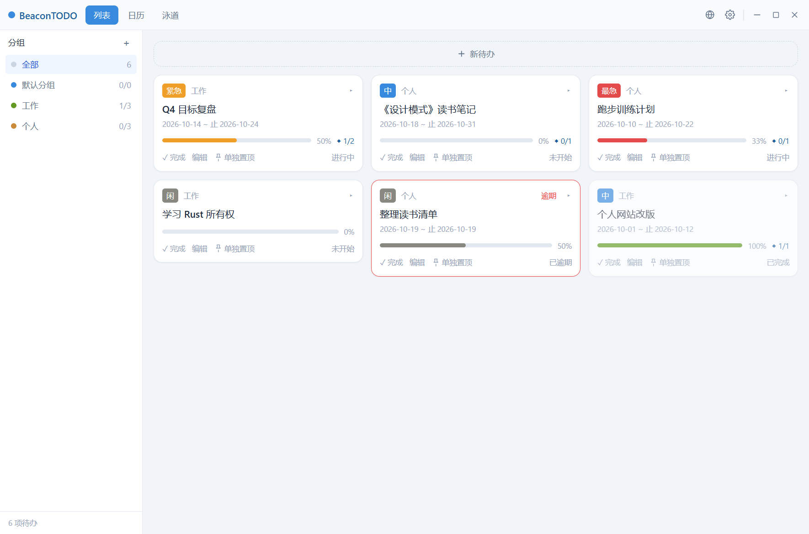
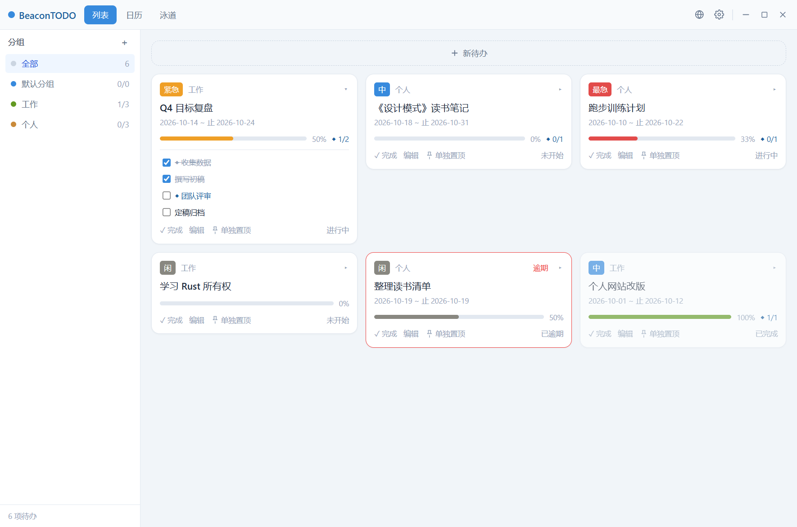
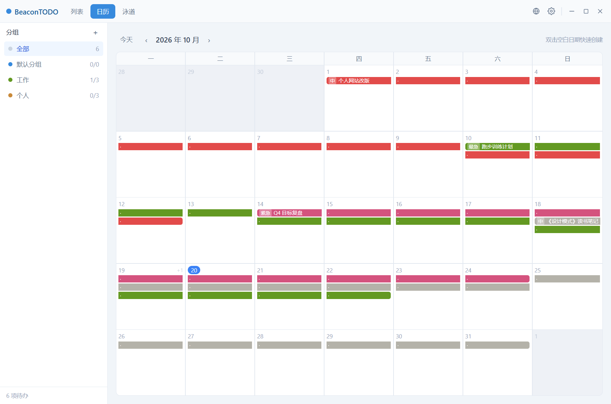
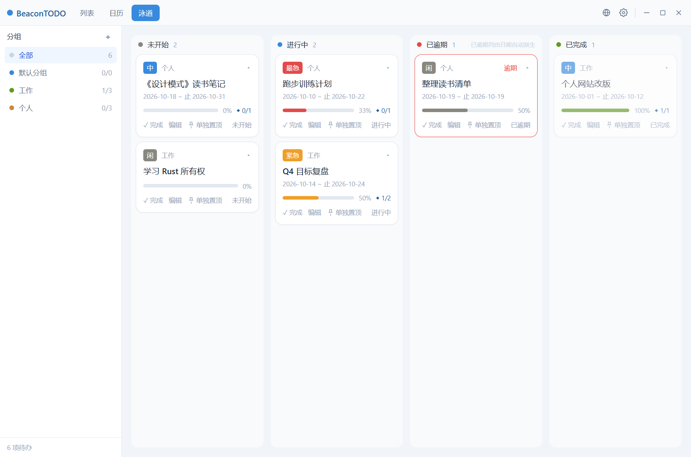
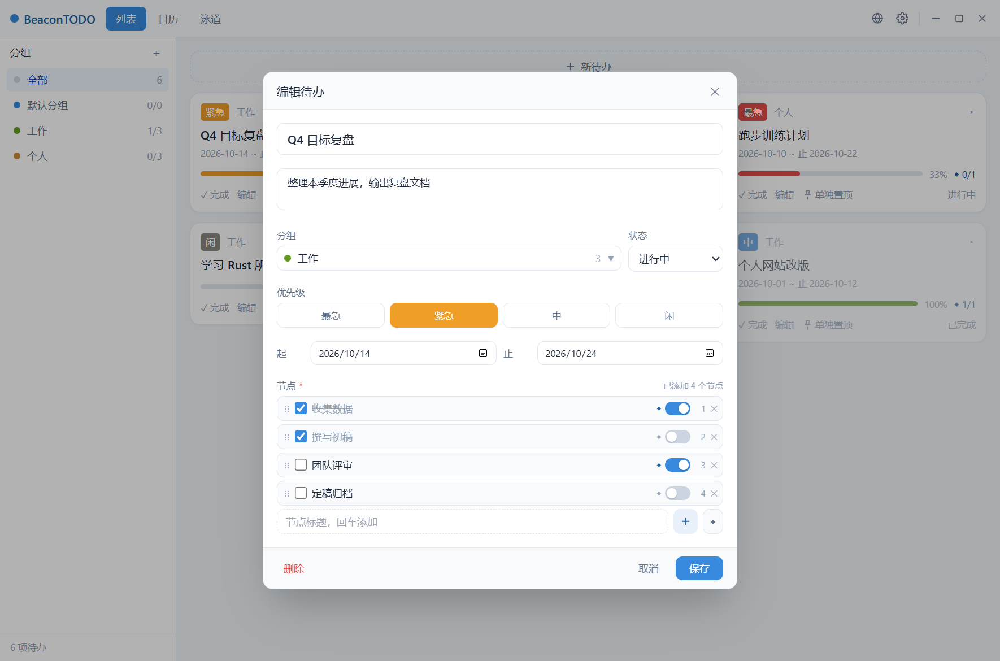
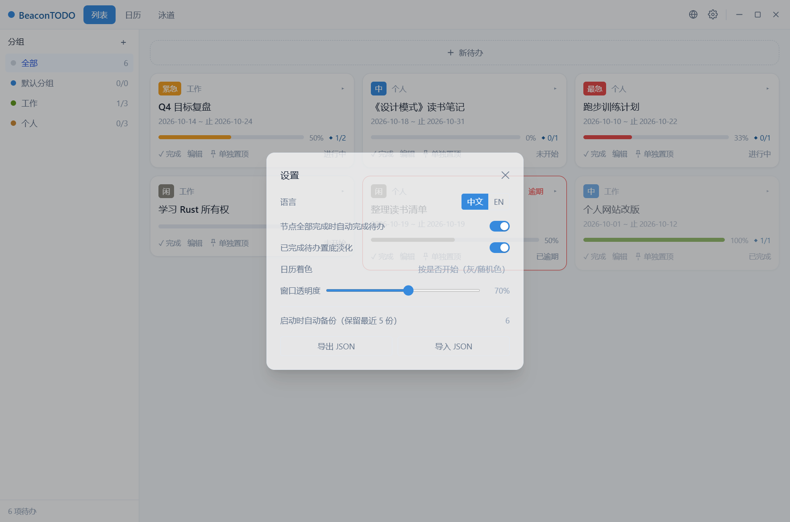

# BeaconTODO（灯塔）

**把一件事拆成节点，把关键节点标成里程碑，把待办钉在屏幕最上面。**

[](https://tauri.app)
[](https://react.dev)
[](https://www.typescriptlang.org)
[](https://www.rust-lang.org)
[](#平台支持)
[](#数据与隐私)

BeaconTODO 是一款本地优先的桌面待办管理器：用「分组 ▸ 待办 ▸ 节点」三级结构拆解事务，节点可一键标记为里程碑；提供列表、日历、状态看板三种视图；任意待办可钉成桌面置顶小窗，随手勾选、随时查看。

安装包约 **2 MB**，零账号、零网络请求，数据全部存在本地 SQLite。



## 为什么做这个

日常并行处理多个项目时，普通待办应用有两个绕不过去的痛点：

1. **事情拆不细** —— 「等保整改」这种待办背后有十几个步骤，没有一个有序的节点结构，整体进度就完全不可见。
2. **关键待办看不到** —— 正在推的那条待办被层层窗口盖住，希望它能像便签一样钉在屏幕最上层，随手就能勾一下。

BeaconTODO 的答案：节点负责"拆解与进度"，里程碑负责"关键检查点"，置顶小窗负责"常驻速达"。

## 核心特性

### 组织与执行

- **分组 ▸ 待办 ▸ 节点**：待办可拆成有序节点，节点支持备注、起止日期、完成状态
- **里程碑 = 节点标记**：节点行内滑块一键标记 `◆` 里程碑，无需维护独立的里程碑列表
- **拖拽排序只改顺序**：节点拖拽**仅调整排序，不改动日期、里程碑、完成状态等任何属性**（有专门的回归测试守住）
- **优先级四档**：P0 最紧急 / P1 紧急 / P2 一般 / P3 闲时
- **进度自动推导**：完成度以百分比展示，有里程碑时额外显示 `◆ 已完成/总数`
- **卡片就地展开**：点击卡片直接展开节点清单并勾选，不必先进编辑器



### 三种视图

| 视图 | 说明 |
| --- | --- |
| 列表 | 卡片流，优先级徽章 + 分组 + 进度，支持就地展开节点 |
| 日历 | 横条横跨起止日期，无结束日期只在当天显示；起始日带优先级短标；未开始灰、已开始稳定随机色 |
| 状态看板 | 未开始 / 进行中 / 已逾期 / 已完成四列，跨列拖拽即改状态（逾期列按日期自动派生） |

<p align="center">
  
  
</p>

### 置顶小窗（Pin）

- 无边框、始终置顶、自由拖动、位置记忆，重启后自动恢复
- **单独 pin** 与**合并 pin** 双模式：多个待办可在同一小窗内切换
- 同一待办不重复开窗（再次置顶会聚焦已有窗口）
- 小窗内可直接新建/编辑待办（复用主窗口同一套弹窗），改动实时同步到主窗口
- 齿轮面板管理成员、排序与透明度，点击面板外自动收起

### 体验细节

- **窗口透明度**：主窗口与置顶小窗各一个 35%–100% 滑块，**只淡化背景、文字始终清晰**，重启后保留
- **统一编辑弹窗**：新建与编辑共用同一表单（标题/备注/分组/优先级/状态/日期/节点），本地草稿、保存才提交，取消不留脏数据
- **无节点不可保存**：每个待办至少要有 1 个节点，从结构上保证"进度"有意义
- **删除有确认**：主题化危险确认框，删除幂等（重复删除不报错），并自动从置顶窗移除
- **自定义标题栏**：整条标题栏兼作窗口标签页与拖拽区，窗口控制靠右，语言与设置图标化
- **系统托盘**：左键唤起主窗口；右键菜单提供最近任务、关闭所有置顶、设置、退出
- **中英双语**：即时切换并持久化，托盘菜单同步
- **动效**：视图切换、弹窗、卡片悬浮均有过渡，并遵循系统「减少动效」偏好

<p align="center">
  
  
</p>

## 技术栈

| 层 | 选型 |
| --- | --- |
| 桌面容器 | Tauri 2（WebView2 / WKWebView，安装包约 2 MB） |
| 前端 | React 18 + TypeScript + Vite + Zustand + Tailwind CSS |
| 交互 | dnd-kit（拖拽）、framer-motion（动效）、react-i18next（i18n） |
| 存储 | SQLite（rusqlite bundled），可回滚迁移，启动自动备份 |

## 架构

刻意把**领域核心**与**桌面外壳**拆成两个 crate，核心不依赖 Tauri，因此可以脱离 GUI 独立测试：

```
BeaconTODO/
├── core/                       # beacon-core：纯 Rust 领域核心（无 Tauri 依赖）
│   ├── src/db/                 # 连接池 + 可回滚迁移（schema 唯一权威）
│   ├── src/repositories/       # SQL 数据访问
│   ├── src/services/           # 业务规则与事务
│   └── tests/                  # 集成测试（覆盖核心规则）
├── src-tauri/                  # Tauri 应用外壳
│   ├── src/commands/           # 命令层：解析参数，不含业务逻辑
│   ├── src/pin/                # 置顶小窗窗口创建
│   ├── src/tray.rs             # 系统托盘与菜单
│   ├── src/window_ops.rs       # 窗口透明度持久化
│   └── capabilities/           # 权限配置
├── src/                        # React 前端
│   ├── components/             # 侧栏 / 列表 / 日历 / 看板 / 弹窗 / 设置
│   ├── pin/                    # 置顶小窗入口（独立 HTML 入口）
│   ├── store/                  # Zustand 全局状态
│   ├── lib/                    # invoke 封装、API 层、透明度、视觉常量
│   └── i18n/                   # 语言包（zh-CN / en-US）
├── docs/                       # 产品文档（PRD）与截图
└── .github/workflows/          # CI：Windows + macOS 构建验证
```

调用链固定为 `命令层(commands) → 领域服务(services) → 仓储(repositories) → SQLite`，命令层不做业务判断，服务层不关心窗口与 IPC。

## 快速开始

### 直接使用

前往 [Releases](https://github.com/Zer0ON1/BeaconTODO/releases) 下载对应平台的安装包：

- **Windows**：`BeaconTODO_x.y.z_x64-setup.exe`（NSIS 安装包）或便携版 `beacon-todo.exe`
- **macOS**：`.dmg`（由 CI 构建验证）

首次启动会在用户数据目录自动创建数据库并备份，无需任何配置。

### 从源码构建

前置要求：

- Node.js 20+
- Rust stable（Windows 建议 MSVC 工具链；macOS 需 Xcode Command Line Tools）
- Windows 需 WebView2 运行时（Windows 11 自带）

```bash
npm install            # 安装前端依赖
npm run tauri dev      # 开发模式（前端热重载 + Rust 自动重建）
npm run tauri build    # 打包安装包（产物见 src-tauri/target/release/bundle/）
```

其他常用命令：

```bash
npm run build                 # 前端类型检查 + 构建
cd core && cargo test         # 领域核心集成测试（无需 GUI/WebView）
```

## 测试

核心业务规则由 `core/tests/core_rules.rs` 上的集成测试守护，跑在内存 SQLite 上，不依赖 GUI：

| 用例 | 守护的规则 |
| --- | --- |
| `reorder_only_changes_sort_order` | 拖拽只改 `sort_order`，其他字段逐项不变 |
| `reorder_rejects_invalid_payload` | 非法排序载荷被拒绝 |
| `node_milestone_flag_toggles` | 里程碑滑块开关与持久化 |
| `auto_complete_and_reopen` | 节点全部完成 → 待办自动完成；取消完成可回退 |
| `delete_group_cascade` / `delete_group_migrate` | 删除分组支持级联删除或迁移待办 |
| `delete_todo_is_idempotent` | 重复删除静默成功，不报 `not found` |
| `delete_todo_detaches_from_pin_windows` | 删除待办自动从置顶窗移除，空窗关闭 |
| `export_import_roundtrip` | JSON 导出 → 导入闭环 |
| `backup_rotation_keeps_five` | 启动备份保留最近 5 份 |

```bash
cd core && cargo test
```

## 平台支持

- **Windows 10/11**：主要开发与发布平台
- **macOS**：通过 GitHub Actions 构建验证（产物 `.app` / `.dmg`），未做深度交互适配
- **Linux**：暂不在计划内

## 数据与隐私

- **零网络请求、零账号**：应用不发起任何外部请求，没有遥测
- 数据存放位置：
  - Windows：`%APPDATA%\com.beacontodo.app\beacon.db`
  - macOS：`~/Library/Application Support/com.beacontodo.app/beacon.db`
- 启动时自动备份到同目录 `backups/`，默认保留最近 **5** 份
- 支持全量 JSON 导出 / 导入（设置面板）

## 路线图

- [x] v0.1：分组 / 待办 / 节点 / 里程碑标记、列表·日历·看板、置顶小窗、导出备份、中英双语
- [x] v0.1.x：编辑弹窗统一、窗口透明度、跨窗口实时同步、卡片就地展开、里程碑进度
- [ ] 撤销 / 重做
- [ ] 全局搜索与筛选
- [ ] 周视图日历、批量操作
- [ ] 深浅主题切换、点击穿透
- [ ] 提醒通知与完成统计

## 贡献

欢迎提 Issue 与 PR。提交前请确保：

```bash
npm run build      # 前端类型检查与构建
cd core && cargo test   # 核心测试全绿
```

因为核心规则（尤其是"拖拽只改顺序"）有测试保护，改动相关逻辑时请同步更新测试用例。

## 许可证

本项目采用 [Apache License 2.0](LICENSE) 许可证。
